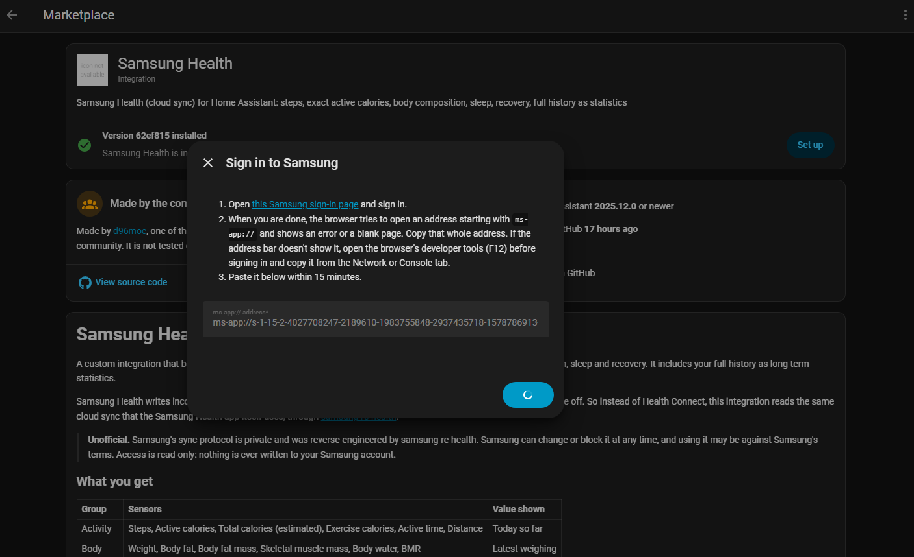
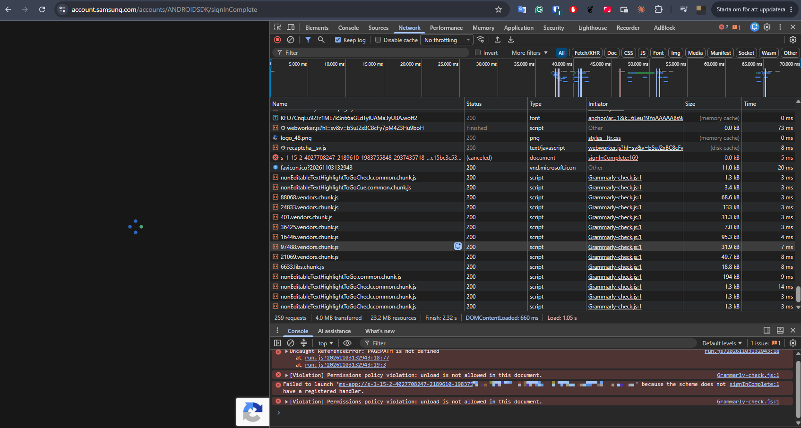

# Samsung Health for Home Assistant

A custom integration that brings your **Samsung Health** data into Home Assistant:
steps, active calories, body composition, sleep and recovery. It includes your full
history as long-term statistics.

Samsung Health writes incomplete data to Android's Health Connect: active calories
are missing entirely and the totals are off. So instead of Health Connect, this
integration reads the same cloud sync that the Samsung Health app itself uses, through
[samsung-re-health](https://github.com/charlesbel/samsung-re-health).

> **Unofficial.** Samsung's sync protocol is private and was reverse-engineered by
> samsung-re-health. Samsung can change or block it at any time, and using it may be
> against Samsung's terms. Access is read-only: nothing is ever written to your
> Samsung account.

## What you get

| Group | Sensors | Value shown |
|---|---|---|
| Activity | Steps, Active calories, Total calories (estimated), Exercise calories, Active time, Distance | Today so far |
| Body | Weight, Body fat, Body fat mass, Skeletal muscle mass, Body water, BMR | Latest weighing |
| Sleep | Sleep duration, Sleep score, Bedtime, Wake-up time | Last night |
| Recovery | Sleeping heart rate, Sleeping HRV, Energy score | Latest day |
| Status | Last cloud sync, Cloud sync stale (problem) | — |
| Control | Sync now (button) | Downloads right away instead of waiting for the next poll |

**Getting the very latest data.** Home Assistant can only read what your phone has
already synced to Samsung Cloud, and Samsung doesn't publish how often the app does
that. To be sure, open Samsung Health → Settings → *Sync with Samsung Cloud* → **Sync
now** on the phone, then press **Sync now** in Home Assistant.

- **Exact values.** Steps, active calories and per-workout calories match the Samsung
  Health app exactly. This was checked against the app's final daily values over 29 days.
- **Estimated total calories.** Samsung doesn't store total calories in its cloud data.
  The integration estimates it as `BMR + 0.82 × active calories`, using the median BMR
  of your last 7 weighings. Over those 29 days it was within ±54 kcal of the app, with
  a typical error of ±25 kcal.

### History

Your full history, going back as far as your Samsung Health data does, is imported
into Home Assistant's long-term statistics:

- **Body, sleep and recovery** values are imported onto the sensors themselves. Open
  *Weight*, for example, in the History panel or its more-info dialog, and you see
  every weighing back to the first one.
- **Daily totals** (steps, active, total and exercise calories) are separate
  statistics: `ha_samsung_health:steps`, `ha_samsung_health:active_calories`,
  `ha_samsung_health:total_calories` and `ha_samsung_health:exercise_calories`. Their
  sensors restart from zero every midnight, so these totals can't share the sensor's
  own statistics without breaking them when your phone syncs a past day late. Show
  them as daily bars with a Statistics Graph card:

  ```yaml
  type: statistics-graph
  title: Steps per day
  entities:
    - ha_samsung_health:steps
  period: day
  stat_types:
    - change
  chart_type: bar
  days_to_show: 30
  ```

## Requirements

- **Cloud sync on your phone.** Samsung Health must be syncing to Samsung Cloud. Check
  Samsung Health → Settings → *Sync with Samsung Cloud*. If it's off, this integration
  sees nothing new; the *Cloud sync stale* sensor turns on after 24 hours without new
  data.
- **Home Assistant 2025.12 or newer.**

## Installation

1. In Home Assistant, open Marketplace (formerly HACS) and add this repository as a
   custom repository (type *Integration*).
2. Install **Samsung Health** and restart Home Assistant.
3. Go to Settings → Devices & services → Add integration → **Samsung Health**.

## Signing in

Samsung's sign-in is made for its Windows app. When it's done, Samsung sends the
browser to an address starting with `ms-app://` that only that app can open. Your
browser can't open it, so nothing visible happens. The address carries the sign-in,
and you copy it from the browser's developer tools.

**Use a computer with Chrome or Edge.** Phone browsers have no developer tools.
Installing the integration from the phone is fine; only this step needs the computer.

The setup dialog looks like this:



1. **Copy the link.** In the setup dialog, right-click *this Samsung sign-in link* and
   choose **Copy link address**. Leave the dialog open.
2. **Open the developer tools in a new tab.** Open a new browser tab, press **F12**,
   and select the **Network** tab in the panel that opens.
3. **Sign in.** Paste the link into that tab's address bar, press Enter and sign in to
   your Samsung account.
4. **Find the address.** After you sign in, the page stays blank with a spinning
   icon. That is expected. In the Network list, find the **red row** with status
   **(canceled)**, whose name starts with `s-1-15-2-`. Right-click it and choose
   **Copy → Copy URL**.

   

   The Console tab shows the same address in a red error:
   `Failed to launch 'ms-app://…' because the scheme does not have a registered
   handler`. It shortens the address with `…` in the middle, though, so copy it from
   the Network tab.
5. **Paste it into the setup dialog within 5 minutes**, and select **Submit**. The
   address starts with `ms-app://` and is several hundred characters long. The code
   in it expires after 5 minutes (`code_expires_in=300`) and works only once.
6. **Wait for the download.** The dialog shows *Signed in to Samsung* while it
   downloads your history. This usually takes under a minute, and setup then
   finishes by itself.

If the address isn't accepted, the dialog creates a new sign-in link. Start again
from step 1.

The sign-in is a one-time step. Samsung only accepts this callback address for the
client id that samsung-re-health uses, so a smoother "enter a code on a web page"
sign-in isn't possible.

The sign-in is stored under `/config/.storage/ha_samsung_health/` and is refreshed
automatically. If Samsung stops accepting it, Home Assistant asks you to sign in again.

## Workouts in ha-workouts

Individual workouts (type, duration, Samsung's calories, heart rate) are available to
the [ha-workouts](https://github.com/d96moe/ha-workouts) fork as its *Samsung Health*
source:

- Set up this integration first, then add the source in ha-workouts.
- No second sign-in is needed: ha-workouts reads the sessions this integration has
  already downloaded.

## How it works and its limits

- **Polling.** The integration polls every 60 minutes by default. You choose 15, 30,
  60 or 120 minutes in the setup dialog, and you can change it later under
  *Configure*. A change takes effect without reloading the integration, from the
  next scheduled poll.
- **Never holds up Home Assistant's startup.** The download runs in the background.
  Until the first one after a restart finishes, the sensors show their values from
  before the restart. "Today" values (steps, calories) are only restored if they are
  from today.
- **Temporary Samsung errors.** Samsung's server sometimes answers with an error
  (HTTP 500). The integration retries that request twice, after 2 and 5 seconds,
  before giving up. If it still fails, the poll is retried later and the sensors
  keep their last values.
- **Full download on every poll.** Samsung's server ignores date filters, so each poll
  downloads your full history for six data types: about 13,000 records in roughly
  15–20 read-only requests, taking about 10 seconds for ten years of data. Data is
  never fresher than your phone's sync to Samsung Cloud, so polling more often gains
  little.
- **History is written to statistics once.** It is written right after you first set
  up the integration. After that, a small fingerprint per statistic and month (kept in
  `.storage`) means each poll, including the first one after a restart, writes only the
  months that changed (normally the current one). Rows are updated in place by
  timestamp, so nothing is ever duplicated. The integration uses Home Assistant's
  regular statistics API, never direct database access.
  - If the statistics are deleted from the recorder, they are written again in full on
    the next poll.
- **Freshness.** Data is only as fresh as the phone's sync to Samsung Cloud.
- **Library workarounds.** Two problems in samsung-re-health 0.7.2 are worked around
  without modifying it:
  - EU sign-in fails because Samsung returns its sign-in server without `https://`.
  - Some data types have outdated schema revisions. Samsung's error reply names the
    current revision, and the integration retries with it.
- **Diagnostics.** The diagnostics download contains only counts and statuses: no
  health values, ids or tokens.

## Development

```
python -m venv .venv
.venv/bin/pip install -r requirements_test.txt
.venv/bin/python -m pytest tests
```

The Home Assistant test plugin needs Linux. See [ci/README.md](ci/README.md).

## License

MIT
